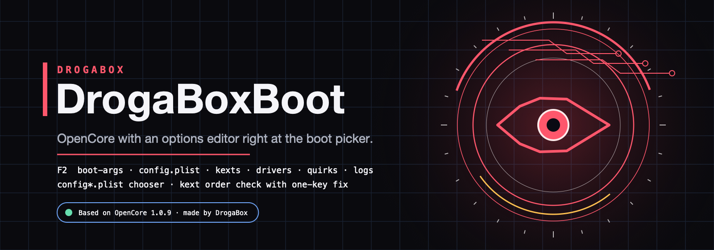
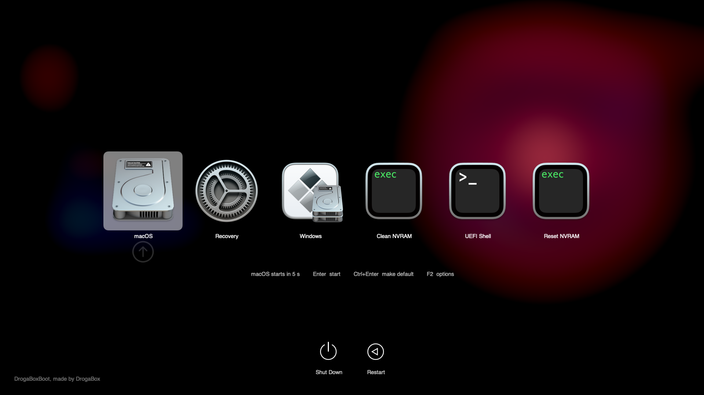
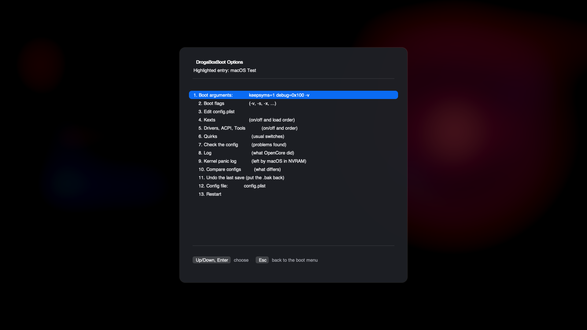
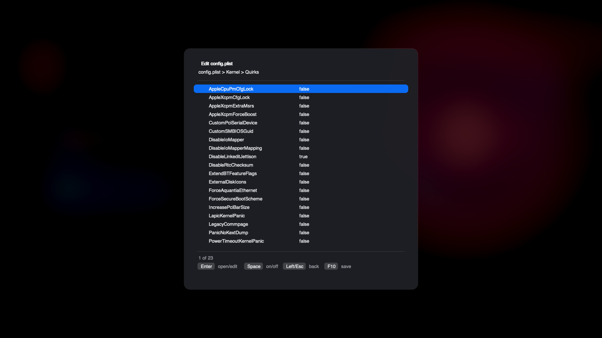
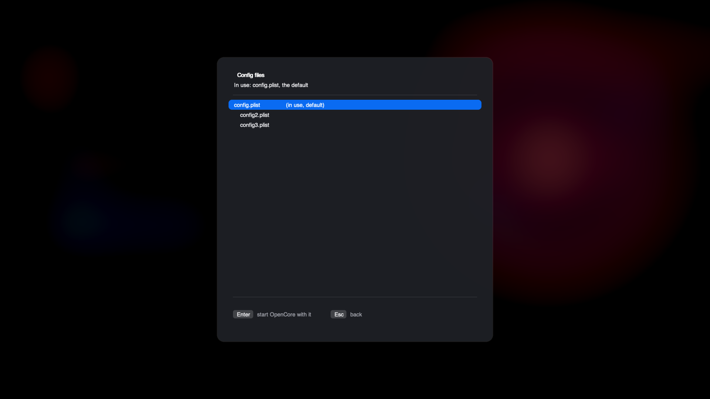
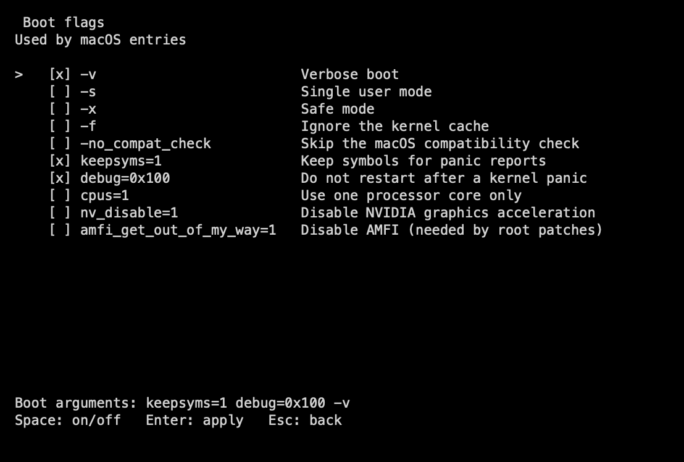
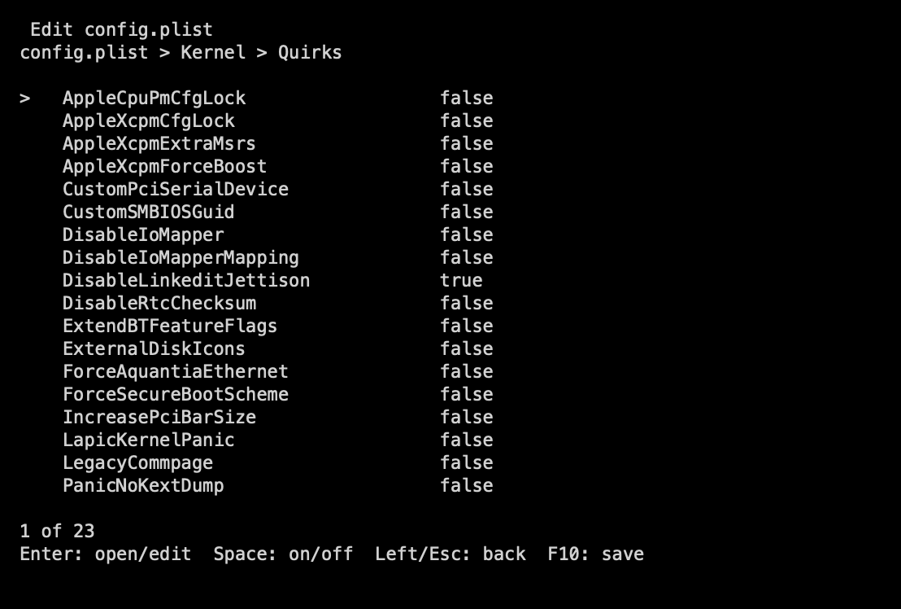
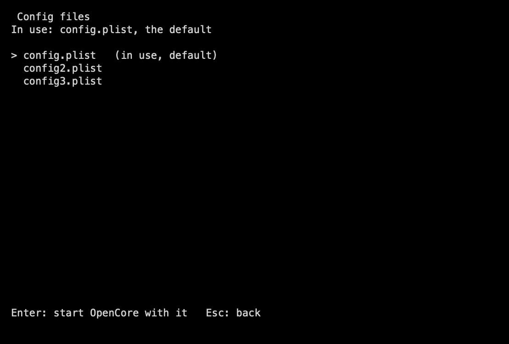

<p align="center">
  
</p>

<p align="center">
  <b>Fix your Hackintosh from the boot picker.</b><br>
  Press <code>F2</code>: change boot-args, switch kexts, reorder them, pick another config, read the last kernel panic.<br>
  No USB stick, no second computer, no other OS.
</p>

<p align="center">
  
</p>

<p align="center">
  <a href="#install">Install</a> ·
  <a href="#the-picker">The picker</a> ·
  <a href="#what-you-get">The editor</a> ·
  <a href="../DrogaBox/EDITOR.md">Editor guide</a> ·
  <a href="#build-it-yourself">Build</a> ·
  <a href="#credits">Credits</a>
</p>

---

## Why

A Hackintosh doesn't boot. You need `-v`, or to turn off the kext you added last night, or to go back to
the config that worked. With stock OpenCore that means another machine, a USB stick and a plist editor.

**DrogaBoxBoot** is OpenCore with an options editor at the boot picker. Press `F2`, fix it, restart.
And a picker that looks like it belongs on a Mac: sized for your screen, readable, with the AETHER theme
built in.

It is the official [acidanthera/OpenCorePkg](https://github.com/acidanthera/OpenCorePkg). Everything else
works and boots as it does there. Our changes sit on top as separate commits, and one command moves them to
each new official release.

## The picker

<table>
<tr>
<td width="50%"></td>
<td width="50%"></td>
</tr>
<tr>
<td><b>Sized for 1080p.</b> Stock OpenCanopy draws 1080p screens at 1x: small icons and 10 px text. Here the
2x artwork is drawn and shrunk to 1.5x on the way out, so six entries fit in one row and the names are
readable. Under the entries, a countdown and the keys. Restart and Shut Down have their names, like on a Mac.</td>
<td><b>The editor on a sheet.</b> <code>F2</code> no longer drops you into a text console: the editor opens
on a sheet over the dimmed picker, in the theme's font, with the selected row in blue and the keys at the
bottom. Without OpenCanopy it still works in text mode.</td>
</tr>
<tr>
<td></td>
<td></td>
</tr>
<tr>
<td><b>Every screen of the editor</b> works on the sheet: config tree, kexts, quirks, logs, config files.</td>
<td><b>AETHER</b>, the DrogaBoxBoot theme, comes in the zip and is used by default
(<code>PickerVariant</code> <code>Auto</code>). Any theme with 2x images gets the 1.5x picker; set
<code>PickerAttributes</code> bit <code>0x0400</code> to keep 1x.</td>
</tr>
</table>

<sub>These pictures are not mock-ups: they are drawn by the real OpenCanopy code, run on a Mac by
<code>Utilities/TestCanopy</code> (a fake 1920×1080 screen, scripted keys) and saved by
<code>DrogaBox/make-screenshots.sh</code>.</sub>

## What you get

<table>
<tr>
<td width="50%"></td>
<td width="50%"></td>
</tr>
<tr>
<td><b>Options at <code>F2</code>.</b> Opens from OpenCanopy (on the sheet above) and from the text picker
(here). Protected by your OpenCore password if you set one.</td>
<td><b>Boot flags.</b> <code>-v</code>, <code>-x</code>, <code>keepsyms=1</code>, <code>debug=0x100</code>
and others with <code>Space</code>. Apply them <i>for one boot</i>, keep them in NVRAM, or save them to
<code>config.plist</code>.</td>
</tr>
<tr>
<td></td>
<td></td>
</tr>
<tr>
<td><b>Kexts, in load order.</b> Turn them on and off, move them with <code>+</code>/<code>-</code>. Each kext
is checked against the <code>OSBundleLibraries</code> of its <code>Info.plist</code>. A kext loaded before
what it needs (here WhateverGreen before Lilu) gets a <code>!</code> and the reason.</td>
<td><b><code>F5</code> fixes the order.</b> It moves only what has to move and leaves a correct list alone.
Missing kext files get the same <code>!</code>.</td>
</tr>
<tr>
<td></td>
<td></td>
</tr>
<tr>
<td><b>The whole <code>config.plist</code></b> as a tree: booleans, numbers, strings, data. Saved with your
formatting and comments kept, the old file kept as <code>config.plist.bak</code>, and the result reloaded
before anything is written.</td>
<td><b>Several configs.</b> Keep <code>config.plist</code>, <code>config2.plist</code>,
<code>config-test.plist</code>… next to each other and pick one at boot.</td>
</tr>
<tr>
<td></td>
<td>
<b>Also in the menu:</b>
<ul>
<li><b>Drivers, ACPI, Tools</b>, kernel and booter patches: on/off and order</li>
<li><b>Quirks</b>: the usual switches in one list</li>
<li><b>Check the config</b>: structure, kext order, missing files</li>
<li><b>Log</b>: what OpenCore did on this boot</li>
<li><b>Kernel panic log</b>: the panic macOS left in NVRAM, readable without booting</li>
<li><b>Compare configs</b> and <b>Undo the last save</b></li>
</ul>
</td>
</tr>
<tr>
<td><b>Once or for good.</b> Try a config for one start: the next start goes back to <code>config.plist</code>
on its own. A config without the editor can only be used once, so you can always get back.</td>
<td></td>
</tr>
</table>

<sub>The text mode screenshots above come from the real editor code, run on a Mac by the project's test
harness (<code>Utilities/TestPickerEditor</code>, 80×25 console) and drawn by
<code>DrogaBox/make-screenshots.sh</code>.</sub>

## Install

> [!WARNING]
> This is your boot loader. Try it on a **USB stick first**, and keep a copy of your current `EFI` folder.
> If the build you install doesn't match your other OpenCore files, your machine may not boot.

1. [Build it](#build-it-yourself). Ready-made zips will be in [Releases](../../releases) once the first
   build has been boot-tested on real hardware.
2. From the zip's `X64/EFI/OC`, replace **`OpenCore.efi`** and **`Drivers/OpenCanopy.efi`** in your EFI.
   They have to come from the same build. If your current OpenCore is older than 1.0.9, update the rest of
   OpenCore (other drivers, `BOOTx64.efi`) the usual way first.
   For the theme, copy `Resources/Image/DrogaBox` too and use `PickerMode` `External`. The font in
   `Resources/Font` comes from [OcBinaryData](https://github.com/acidanthera/OcBinaryData), as with stock
   OpenCore.
3. In `config.plist`, add under `Misc > Security`:
   ```xml
   <key>AllowPickerEdit</key>
   <true/>
   ```
4. Check the config with `Utilities/ocvalidate` **from the same zip**.
5. Restart. At the picker, press `F2`.

Undo: put your old `OpenCore.efi` and `OpenCanopy.efi` back, or set `AllowPickerEdit` to `false`. The new
key does nothing in stock OpenCore.

Using the vault (`Vault` = `Secure`)? The editor still opens, but it can't change the config (the vault
signature would stop matching), and only `config.plist` can be used.

All options and every screen: **[DrogaBox/EDITOR.md](../DrogaBox/EDITOR.md)**.

## Build it yourself

macOS with Xcode command line tools, plus `nasm` and `mtoc` in `PATH`:

```bash
git clone https://github.com/DrogaBox/DrogaBoxBoot.git
cd DrogaBoxBoot
ARCHS=X64 TARGETS=RELEASE,DEBUG TOOLCHAINS=XCODE5 ./build_oc.tool
```

The zips end up in `Binaries/`. The first run downloads the UDK into `UDK/`.

Tests: 1193 checks for the picker editor, 84455 for the plist writer, and the OpenCanopy picker and
editor sheet drawn on the host (zoom, 1x fallbacks, keys, every editor screen), plain and with
AddressSanitizer/UBSan:

```bash
OC_RESOURCES=/path/to/OcBinaryData/Resources DrogaBox/run-tests.sh
```

## How it stays current

The official OpenCore commit we build on is pinned in [`DrogaBox/BASE.md`](../DrogaBox/BASE.md) (now
`ebea824`, 2 Nov 2026, between 1.0.8 and 1.0.9). To move to a newer official commit:

```bash
DrogaBox/update-base.sh            # official master
DrogaBox/update-base.sh 1.0.9      # a given tag or commit
```

It works in a separate worktree. It replays our commits on the new base, runs the tests and builds RELEASE and
DEBUG. It moves `main` only if all of that passed. On a conflict it stops, names the file, and leaves `main`
as it was.

Versions are the OpenCore base plus our number: **`1.0.9-db.1`**. In NVRAM, the
`opencore-version` stays in OpenCore's own format (`REL-109-…`), so Hackintool, OCLP and similar tools see a
normal OpenCore.

## Credits

- **[Acidanthera](https://github.com/acidanthera/OpenCorePkg)**: OpenCore itself (BSD-3-Clause, see
  [`LICENSE.txt`](../LICENSE.txt)). Please don't send DrogaBoxBoot issues to them.
- **Illia Haidai** ([OverlordDev/OpenCorePkg](https://github.com/OverlordDev/OpenCorePkg)): the original
  options editor, config chooser and kexts screen. The first two commits here are his, with his authorship
  kept.
- **DrogaBox**: the 1.5x picker, the editor sheet, the AETHER theme, the host test harnesses, base tracking
  and packaging. The icons of AETHER are those of the GoldenGate theme of
  [OcBinaryData](https://github.com/acidanthera/OcBinaryData).

<p align="center"><sub>made by <b>DrogaBox</b></sub></p>
