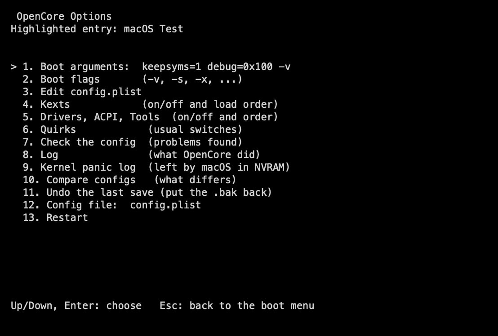
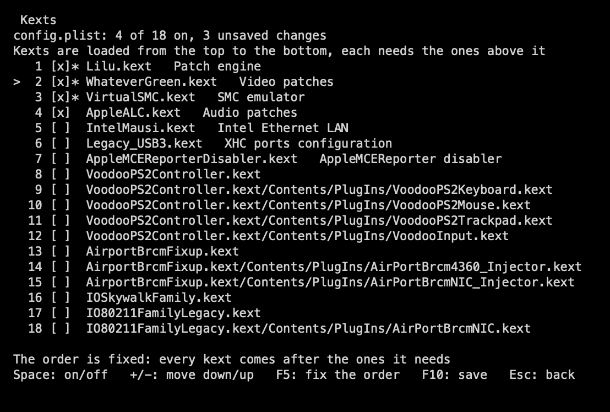
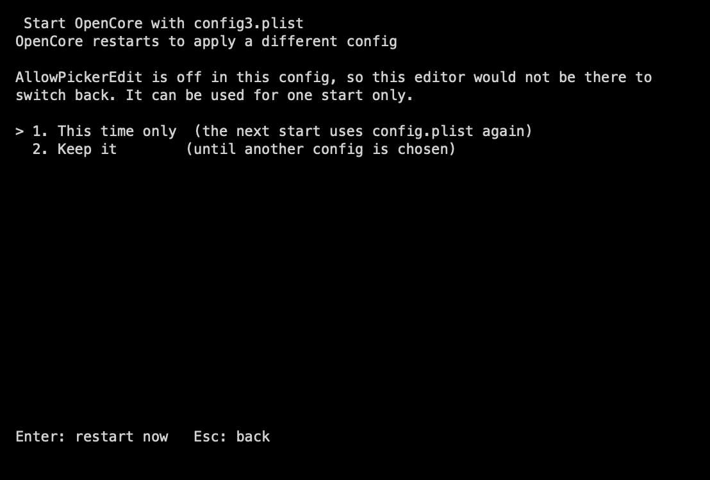

<p align="center">
  
</p>

My OpenCore fork. I wanted two things stock OpenCore doesn't do:

- Fix the config from the boot picker. Press `F2` and you can add `-v`, turn off the kext you installed
  last night, go back to a config that worked, or read the last kernel panic, all without a USB stick
  and a second machine.
- A picker that doesn't look tiny on a 1080p monitor.

Everything else is plain [acidanthera/OpenCorePkg](https://github.com/acidanthera/OpenCorePkg). My changes
are separate commits on top, and a script moves them to each new OpenCore release.

> [!NOTE]
> The editor and the picker run in the test harnesses below, but this build hasn't been booted on real
> hardware yet. There are no release zips until it has.


## The picker

Stock OpenCanopy draws 1080p at 1x, so the icons are small and the text is 10 px tall. This one draws the
2x artwork and scales it down to 1.5x on output. Six entries fit in a row and the names are readable. Under
the entries there's a countdown and the keys, and Restart and Shut Down have labels.

Any theme with 2x images gets this. To keep 1x, set bit `0x0400` in `PickerAttributes`.

The zip comes with my theme, AETHER, and `PickerVariant` `Auto` picks it. The icons are the GoldenGate
ones from [OcBinaryData](https://github.com/acidanthera/OcBinaryData); the background is mine.

## The F2 editor

In OpenCanopy it opens on a sheet over the picker:

| | |
|---|---|
|  |  |

With the text picker it uses the console, like the rest of OpenCore. What it can do:

- Boot flags (`-v`, `-x`, `keepsyms=1`, `debug=0x100`…) for one boot, kept in NVRAM, or saved to the
  config.
- Kexts in load order. Turn them on and off, move them with `+` and `-`. It reads each kext's
  `OSBundleLibraries` and puts a `!` on any kext loaded before something it needs. `F5` fixes the order.
- The whole `config.plist` as a tree. Saving keeps your formatting and comments, and the old file stays as
  `config.plist.bak`.
- Several configs side by side (`config2.plist`, `config-test.plist`…). Pick one at boot, for good or for a
  single boot; after a single boot it goes back to `config.plist` on its own.
- Drivers, ACPI, tools and patches on and off, quirks, a config check, the OpenCore log, the kernel panic
  macOS left in NVRAM, comparing two configs, and undoing the last save.

If you set an OpenCore password, the editor asks for it. Every screen is in
[DrogaBox/EDITOR.md](../DrogaBox/EDITOR.md).

<details>
<summary>Text mode screenshots</summary>









</details>

All of these screenshots come from the real code. `Utilities/TestCanopy` and `Utilities/TestPickerEditor`
run it on a Mac with a fake screen and scripted keys, and `DrogaBox/make-screenshots.sh` saves the
pictures.

## Install

Try it on a USB stick first and keep a copy of your `EFI` folder. This is your boot loader.

1. [Build it](#build).
2. From the zip's `X64/EFI/OC`, replace `OpenCore.efi` and `Drivers/OpenCanopy.efi`. Both have to come from
   the same build. If your OpenCore is older than 1.0.9, update the rest of it first the usual way.
   For the theme, also copy `Resources/Image/DrogaBox` and set `PickerMode` to `External`. The font in
   `Resources/Font` comes from OcBinaryData, same as stock OpenCore.
3. In `config.plist`, under `Misc > Security`, add:
   ```xml
   <key>AllowPickerEdit</key>
   <true/>
   ```
4. Run `Utilities/ocvalidate` from the same zip on your config.
5. Restart and press `F2` at the picker.

To undo, put your old `OpenCore.efi` and `OpenCanopy.efi` back, or set `AllowPickerEdit` to `false`.
Stock OpenCore ignores that key.

With `Vault` set to `Secure`, the editor opens but can't change the config (the vault signature would stop
matching), and only `config.plist` can be used.

## Build

On macOS with the Xcode command line tools, plus `nasm` and `mtoc` in `PATH`:

```bash
git clone https://github.com/DrogaBox/DrogaBoxBoot.git
cd DrogaBoxBoot
ARCHS=X64 TARGETS=RELEASE,DEBUG TOOLCHAINS=XCODE5 ./build_oc.tool
```

The zips end up in `Binaries/`. The first run downloads the UDK into `UDK/`.

Tests (the editor, the plist writer, and the picker and sheet drawn on the host, plain and with
ASan/UBSan):

```bash
OC_RESOURCES=/path/to/OcBinaryData/Resources DrogaBox/run-tests.sh
```

## Keeping up with OpenCore

The OpenCore commit this is built on is in [`DrogaBox/BASE.md`](../DrogaBox/BASE.md) (`ebea824` right now,
between 1.0.8 and 1.0.9). `DrogaBox/update-base.sh` moves to the latest master, and
`DrogaBox/update-base.sh 1.0.9` moves to a given tag. It replays my commits in a separate worktree, runs the
tests and builds. `main` only moves if all of that passes; on a conflict it stops and tells you the file.

Versions look like `1.0.9-db.1`. The `opencore-version` in NVRAM keeps OpenCore's own format
(`REL-109-…`), so Hackintool, OCLP and the like still see a normal OpenCore.

## Credits

- [Acidanthera](https://github.com/acidanthera/OpenCorePkg) for OpenCore (BSD-3-Clause, see
  [`LICENSE.txt`](../LICENSE.txt)). Please don't send them issues about this fork.
- Illia Haidai ([OverlordDev/OpenCorePkg](https://github.com/OverlordDev/OpenCorePkg)) wrote the original
  options editor, config chooser and kexts screen. The first two commits are his, under his name.
- The rest (1.5x picker, editor sheet, AETHER, test harnesses, packaging) is mine. AETHER's icons are from
  the GoldenGate theme in OcBinaryData.

<p align="center"><sub>made by DrogaBox</sub></p>
