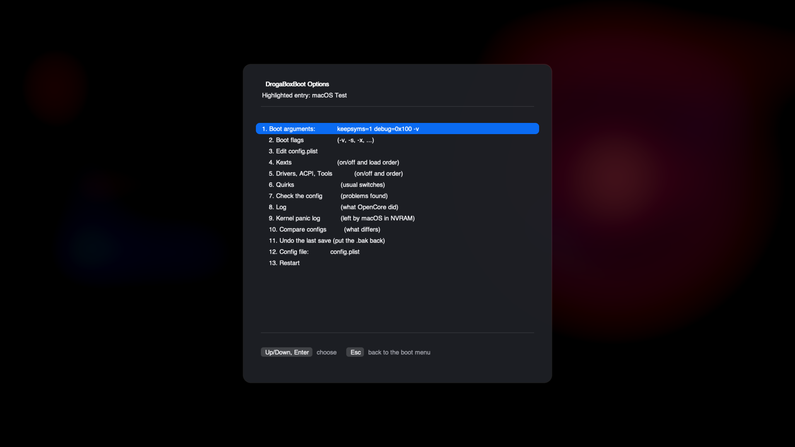
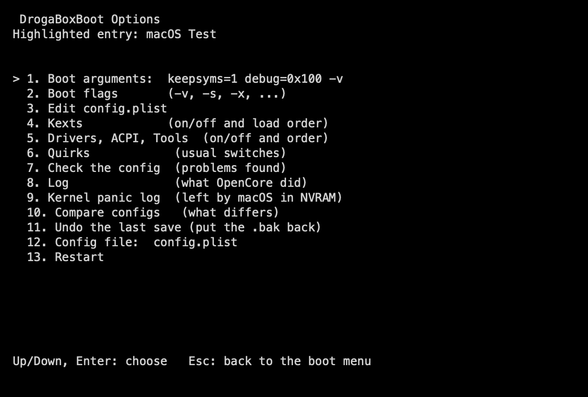
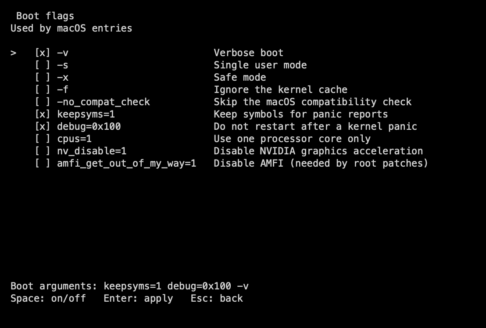
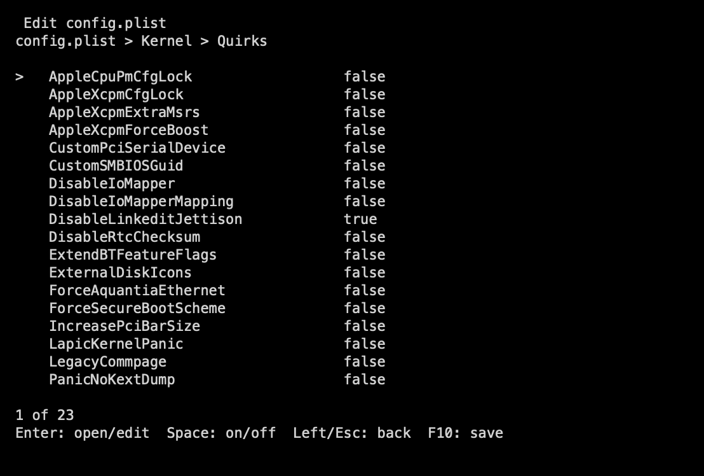
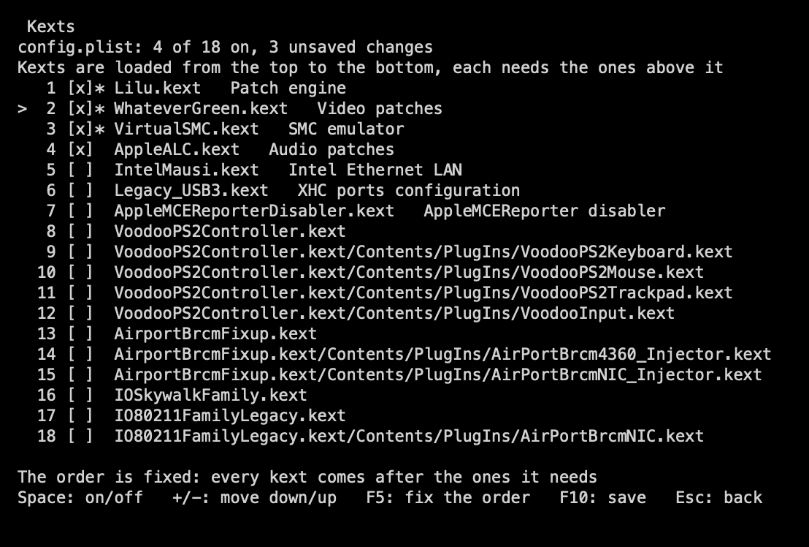
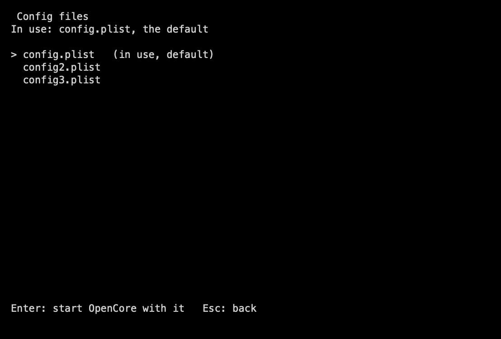
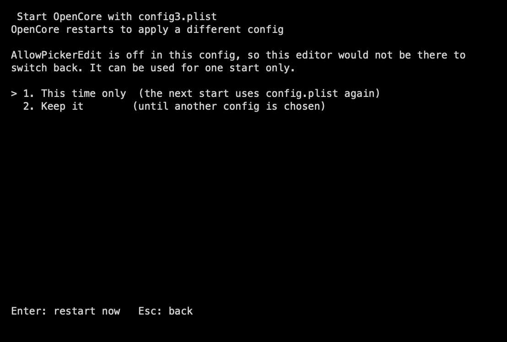

# The options editor (`F2`)

How to turn it on, every screen, and what it does to your files. The authoritative text is the
`AllowPickerEdit` entry in [`Docs/Configuration.tex`](../Docs/Configuration.tex); this page says the same in
short form, with pictures.

## Turning it on

`Misc > Security > AllowPickerEdit` = `true`. Then press `F2` in the picker, either the builtin text picker or
OpenCanopy. With OpenCanopy the editor opens on a sheet over the dimmed picker, in the font of the theme
(below); with the builtin picker, or if the sheet cannot be shown, it uses the text console. The screens and
keys are the same either way. `Esc` goes back to the picker.



The pictures further down are of the text console.

- With `EnablePassword` set, the editor asks for the OpenCore password first.
- With the vault on (`Vault` = `Secure`), the configuration cannot be changed, since it would no longer match the
  vault. Only `config.plist` can be used, because the other files are not in the vault.
- The non-boolean values of `Misc > Security` (`Vault`, `ScanPolicy`, …) can never be changed from the editor.
  A mistake there can stop OpenCore from starting.

Most of the configuration is applied before the picker appears, so changes take effect at the next restart.
The menu has **Restart** for that.



## Boot arguments and boot flags

**Boot arguments** edits the NVRAM `boot-args` variable that macOS reads. **Boot flags** is a list of the usual
ones, switched with `Space`:



Either way, `Enter` asks how to apply them:

| Choice | What happens |
|---|---|
| Boot once | The next start of OpenCore puts the old `boot-args` back. |
| Keep in NVRAM | Stays until changed, like `sudo nvram boot-args=…`. |
| Keep in NVRAM and save to config.plist | Also written to `NVRAM > Add` in `config.plist`. |

With emulated NVRAM (`OpenVariableRuntimeDxe`, `nvram.plist`), "Boot once" may lose the original value.
`NVRAM > Add` brings it back.

## Edit config.plist

The loaded configuration as a tree:



| Key | Action |
|---|---|
| `Enter` | Open a dictionary or array, or edit a value |
| `Space` | Flip a boolean. On a kext, driver or patch, flip its `Enabled` |
| `Left` / `Esc` | Go back up |
| `F10` | Save |

Numbers, strings and data (as hex bytes) can be changed. Keys cannot be added or removed, except
`boot-args`. Long values are cut at the right edge of the screen.

## Kexts

All kexts of `Kernel > Add`, top to bottom, which is the order OpenCore links them in.


| Key | Action |
|---|---|
| `Space` / `Enter` | On / off |
| `+` / `-` | Move down (later) / up (earlier) |
| `F5` | Fix the order |
| `F10` | Save |
| `Esc` | Back (asks about unsaved changes) |

`!` means the kext won't work as configured. The bottom line tells why:

- a kext it needs is loaded **after** it ("Loaded too early, F5 fixes it");
- a kext it needs is switched off, or not in the list at all;
- its `Info.plist` or executable is missing from `Kexts/`, so OpenCore won't add it.

What a kext needs comes from `OSBundleLibraries` (and `OSBundleLibraries_x86_64`) in its `Info.plist`. System
kexts (`com.apple.*`) and enabled `Kernel > Force` entries don't count.

`F5` sorts the switched-on kexts so that each one comes after what it needs. It moves as little as possible
and does nothing to a list that is already right. `*` marks changed rows until you save:



Moving a kext swaps the text of the two entries in `config.plist`. The rest of the file is not touched.
Before writing, the editor reads the result back and checks that it has the same kexts, in the same order
and the same state.

## Drivers, ACPI, Tools and patches

The same list as the kexts screen (on/off, `+`/`-`, `F10`) for `UEFI > Drivers`, `ACPI > Add` and `Patch`,
`Misc > Tools` and `Entries`, `Kernel > Patch` and `Block`, and `Booter > Patch`. `!` marks items whose file is
not in the OpenCore folder.

## Quirks

The boolean quirks of `Booter`, `Kernel`, `UEFI`, `ACPI` and `Misc` that your config has, in one list.

## Check the config

Problems that can be found without booting anything:

- the file's structure, as OpenCore parses it;
- kexts in the wrong order or missing what they need;
- driver, ACPI and tool files that are missing.

It does not judge the values. For that, use `ocvalidate`.

## Log and kernel panic log

- **Log**: the OpenCore log kept in memory, opened at its end. It needs logging on in
  `Misc > Debug > Target`.
- **Kernel panic log**: the panic text macOS saved in NVRAM (`aapl,panic-info`), readable without booting.
  For a useful one, boot with `keepsyms=1 debug=0x100`, and you need NVRAM that keeps what the kernel wrote.

## Config files

Any `config*.plist` in the OpenCore folder can be chosen. The name may use ASCII letters, digits, spaces and
`._-+()`, up to 64 characters.



Choosing another file restarts OpenCore with it:



| Choice | What happens |
|---|---|
| This time only | Next start only, then back to `config.plist` |
| Keep it | Every start until another one is chosen. Only offered if that config also has `AllowPickerEdit`, so there is always a way back. |

The choice is stored in `config.choice` in the OpenCore folder. The first line is the file name, the second is
`once` or `keep` (`once` if missing). **To go back to `config.plist` from another OS, delete
`config.choice`.** A choice that makes no sense is removed. If the chosen file is missing or doesn't load,
OpenCore falls back to `config.plist` and the editor says so.

Saving always applies to the config in use (for example `config2.plist` and `config2.plist.bak`), never to the
others.

## Compare configs and undo

- **Compare configs**: pick another `config*.plist` and see what differs. `-` means only in the first, `+` only
  in the second, `~` changed.
- **Undo the last save**: puts `config.plist.bak` back. The current file becomes the backup, so undo can be
  undone.

## How saving works

1. The change is made in the original text. Formatting and comments are kept.
2. The result is parsed the way OpenCore parses it. It must load with no more problems than the original, or
   nothing is written.
3. The previous file is kept as `<name>.bak`.
4. The written file is read back and compared.

## Trying it without rebooting

The editor runs on macOS with a simulated console and NVRAM:

```bash
cd Utilities/TestPickerEditor
UDK_PATH=../../UDK make
PICKER_TEST_SHOW=1 ./PickerEditor ../../Docs/Sample.plist           # print a sample session
PICKER_TEST_DIR=<copy of EFI/OC> PICKER_TEST_KEXTS=1 ./PickerEditor ../../Docs/Sample.plist   # your kexts, before/after F5
```

Use a **copy** of your `EFI/OC` folder. See [`Utilities/TestPickerEditor/README.md`](../Utilities/TestPickerEditor/README.md).
